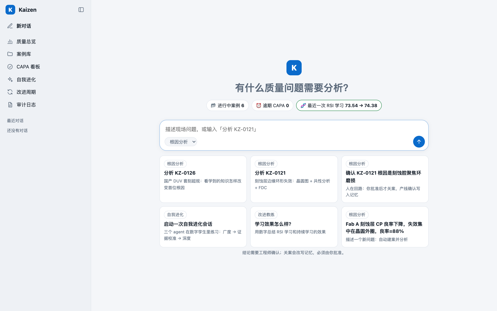
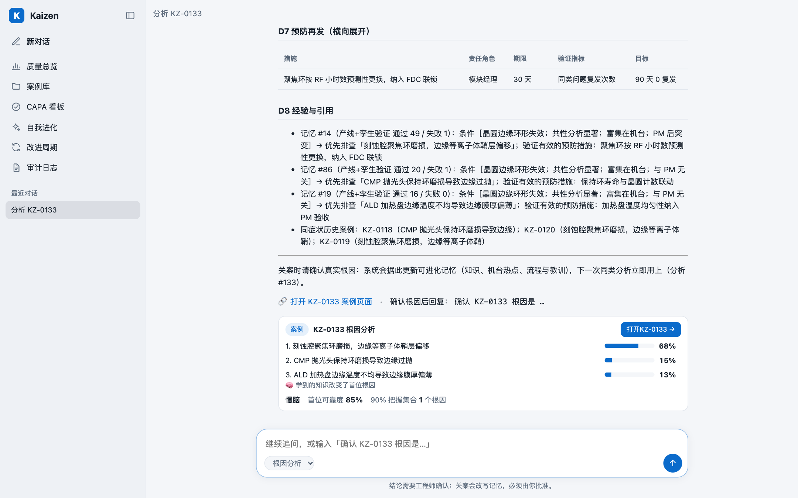
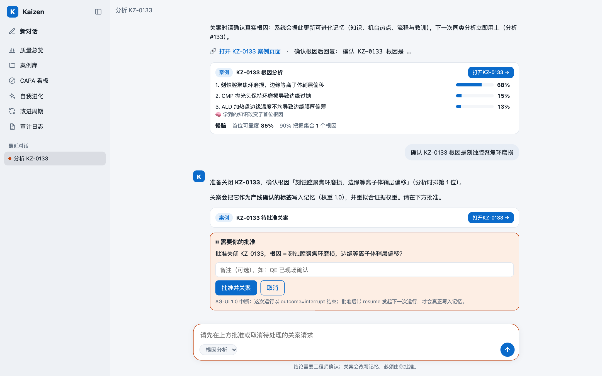
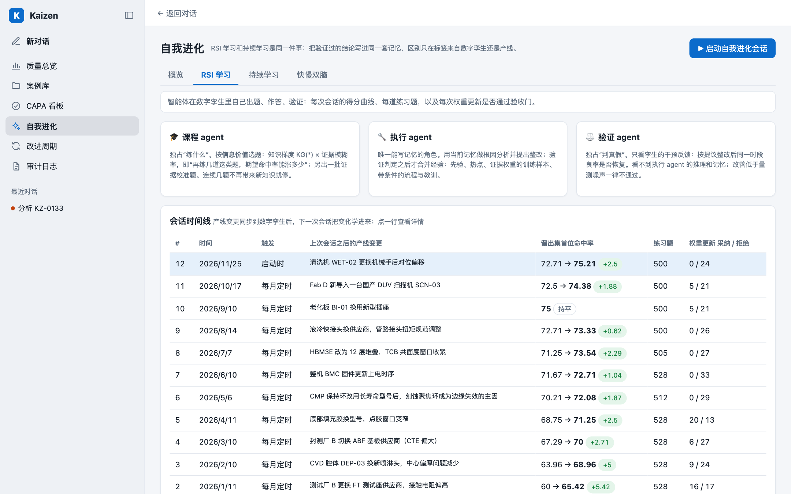
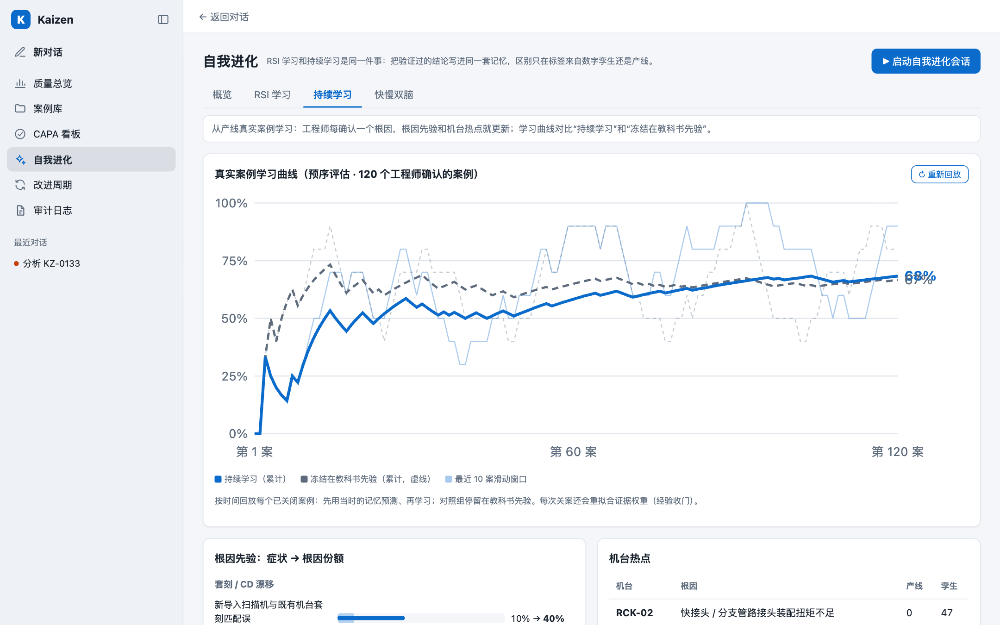
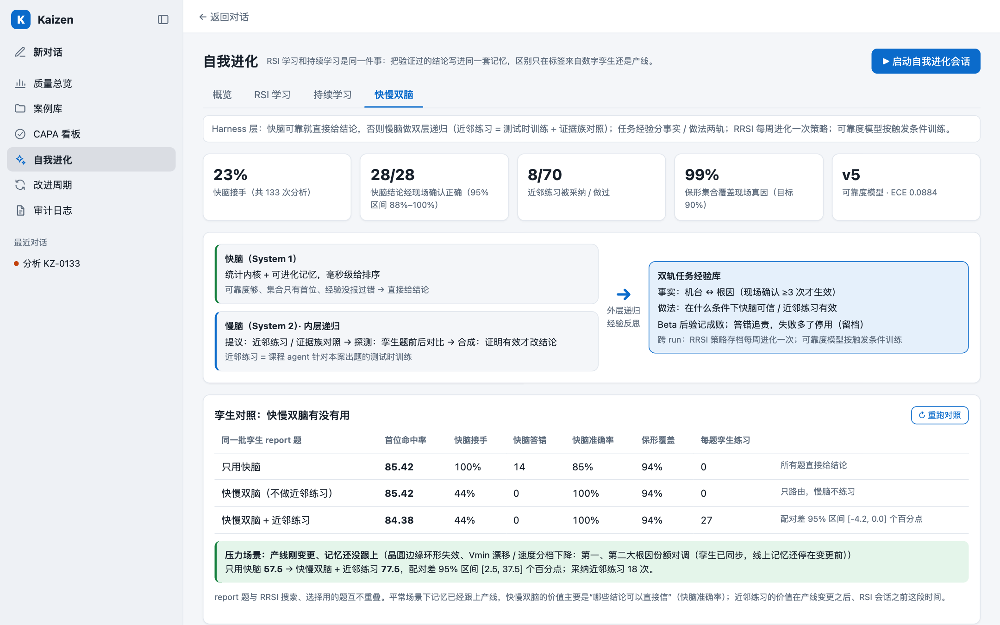
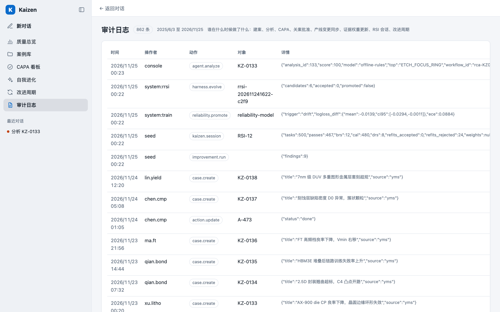
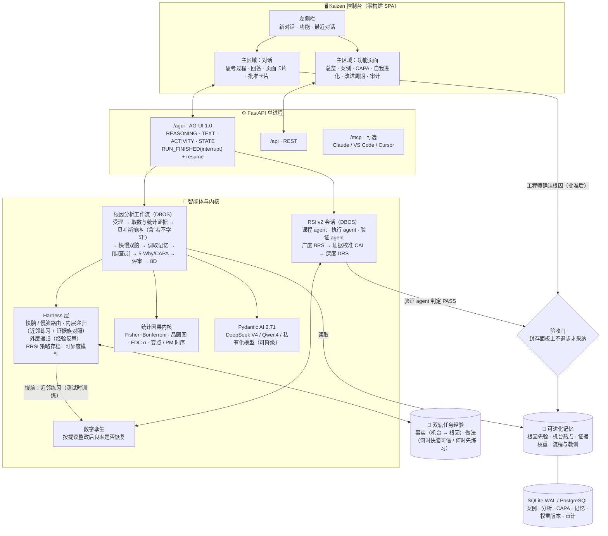
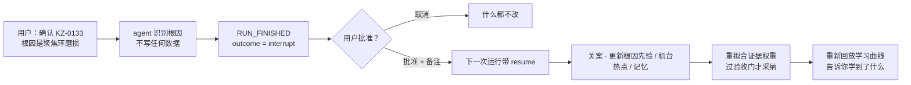

<div align="center">

# 🏭 Industry_RSI（Kaizen）

**面向 AI 芯片制造全流程（前道晶圆 → CP → 2.5D 封装 + HBM → FT/老化/SLT → 液冷整机柜）的质量根因分析智能体。统计因果内核负责可审计的根因排序；RSI 递归自我改进（数字孪生里三个 agent 自主练习）和产线持续学习（工程师确认的真实案例）把验证过的结论写进同一套可进化记忆；Harness 层负责“怎么用这些记忆答题”——快慢双脑、双层递归、双轨任务经验、RRSI 策略进化，外加一个与 RSI 并存的可靠度模型训练机制；控制台基于 AG-UI 1.0，关案必须人工批准。**

[](https://python.org/)
[](https://fastapi.tiangolo.com/)
[](https://docs.ag-ui.com/)
[](https://www.dbos.dev/)
[](https://ai.pydantic.dev/)
[](https://modelcontextprotocol.io/)
[](https://sqlite.org/)
[](https://api-docs.deepseek.com/)
[](backend/tests)

</div>

---

## 📖 项目简介

本项目是一个面向**工业质量场景**的根因分析 + 自我进化 AI Agent 系统，项目内的智能体叫 **Kaizen**（改善）。它参考英伟达供应链和国内晶圆 / 封测大厂的产线，把每一次质量异常变成一个会自我改进的闭环：现场工程师在对话里描述问题或输入案例号，Kaizen 调取 MES / YMS / FDC 数据做统计分析，给出贝叶斯根因排序、5-Why、CAPA 和 8D 报告；工程师确认根因后，系统立刻告诉你它学到了什么。

**RSI 学习和持续学习是同一件事**：都把“验证过的结论”写进同一套记忆，区别只在标签从哪里来。

| 来源 | 结论怎么来 | 权重 | 什么时候发生 |
|---|---|---|---|
| 持续学习（产线） | 工程师确认根因、CAPA 验证有效 / 无效 | 1.0 | 随时 |
| RSI 学习（数字孪生） | 课程 agent 出题 → 执行 agent 作答 → 孪生干预反馈 → 验证 agent 判定 | 0.5 | 按需 / 每晚 |

### 核心架构理念

- **神经-符号复合**：根因排序由统计证据（Fisher 精确检验、晶圆图空间特征、FDC σ 偏移、PM 时序）和可进化记忆给出，过程确定、可审计；大模型只负责理解、解释和写作，没有 Key 时整套系统照常运行。
- **RSI v2**：参照 RSIAgent（arXiv:2609.15364），**不训练任何模型参数**，三个职责分离的 agent 在数字孪生里自主练习。在论文方案上做了三点改进：学习“每类证据该信多少”、加入证据校准批并按信息价值选题、每次更新都必须通过验收门。
- **Harness 层（v0.6）**：参照 Agnes Harness 的快慢双脑与 Google Harness² 的双层递归。证据清楚、可靠度够的案例由快脑直接给结论；新的、难的、有过错的案例转慢脑，在孪生里针对本案做近邻练习（测试时训练）再下结论，并把“什么条件下哪种做法有效”写进双轨任务经验库。harness 的旋钮按 RRSI 的正则化验收跨 run 进化。
- **训练机制与答案可靠性**：训练的不是大模型，而是一个 9 参数的可靠度模型（首位根因是真因的概率），按 A-RSI 的触发规则开训练窗口、过健康门和留出集晋升门；再用保形预测给出“覆盖真因 90%”的根因集合，集合里不止一个根因就明确标“需现场鉴别”。
- **人在回路**：关案会改写产线记忆，agent 不会直接执行，而是以 AG-UI 中断结束这次运行，你批准后才写入；批准人和备注进入审计日志。

### 适用场景

- **晶圆厂 / 封测厂质量工程**：良率下降、晶圆图失效、套刻超规、封装翘曲、HBM 凸点开路等异常的根因分析与 8D
- **新产线冷启动**：没有历史案例时，先在数字孪生里练习，把首位根因命中率从 56.0 提到 73.5（模拟数据）
- **经验沉淀**：工程师每确认一个根因，根因先验、机台热点、证据权重、排查流程都会更新，并能追溯到具体案例
- **Agent 工程实践**：自我改进的三角色制衡、验收门、DBOS 持久化工作流、AG-UI 中断与恢复、离线降级

**一句话总结**：不只是一个根因分析工具，而是一个会自己练习、会从产线学习、每一步都能追溯和撤销的工业质量 Agent。

---

## 📸 应用展示

<div align="center">

| 对话主页 | 对话中根因分析 |
|:---:|:---:|
|  |  |

| 关案需要人工批准 | 案例页面 |
|:---:|:---:|
|  |  |

| 自我进化 · 概览 | 自我进化 · RSI 学习 |
|:---:|:---:|
|  |  |

| 自我进化 · 持续学习 | 自我进化 · 快慢双脑 |
|:---:|:---:|
|  |  |

| 审计日志（去年至今） | |
|:---:|:---:|
|  | |

</div>

演示库按时间回放了 2025-06 至今约 18 个月：138 个案例（120 个已关闭、12 个进行中、6 个待分析）、415 条 CAPA、18 次月度改进周期、11 次产线变更、12 次 RSI 会话、700 多条审计记录，全部带当时的时间。

控制台布局：**主区域默认是对话**；质量总览、案例库、CAPA 看板、自我进化、改进周期、审计日志放在**左侧栏**，点开后在同一主区域完整显示，点“← 返回对话”或任一条最近对话回来。agent 只在消息里放卡片（如“打开 KZ-0133 →”），不会自动切走对话。

---

## 🏗️ 系统架构



**一次关案怎么变成学习**：中断是 AG-UI 1.0 的原生能力，界面不需要特殊协议。



---

## ✨ 核心亮点

### 亮点一：RSI v2，三个角色互相制衡的递归自我改进

| 角色 | 独占的权力 | 做法 |
|---|---|---|
| 课程 agent | 决定练什么 | 按**信息价值**选题：知识梯度 KG(\*) × 证据模糊率，即“再练几道这类题，留出集期望命中率能涨多少”；连续 8 题没有新知识就停 |
| 执行 agent | 唯一能写记忆 | 用当前记忆做根因分析并提出整改；只在验证判定之后合并经验 |
| 验证 agent | 判真假 | 只看孪生的干预反馈：按提议整改后同一时段良率是否恢复；看不到执行 agent 的推理和记忆；改善低于量测噪声一律不通过 |

三个阶段：**广度 BRS**（12 题，按工段轮转保证覆盖）→ **证据校准 CAL**（480 道低成本练习，每波 24 题并行，难度易 : 中 : 难 = 2 : 4 : 4）→ **深度 DRS**（最多 36 题，失败驱动和压力测试）。在线模式下，校准题只用来学证据权重，不改动产线先验。

**产线变更驱动**：产线不是一成不变的。换供应商、新机台导入、PM 程序调整等变更同步到数字孪生后：
- 受影响症状学到的旧份额降权到 20%（部分遗忘），新证据会更快生效；
- 下一次 RSI 会话里，课程 agent 把这些症状的校准题比例提高到 4 倍，这部分校准题也会更新先验。

演示库里过去一年有 11 次产线变更。变更后的 11 次会话中，10 次提升了留出集首位命中率（+0.6 ～ +5.4）；另 1 次（老化板换插座）变更本身没有让命中率下降，结果标为“持平”并写明原因。

### 亮点二：学“每类证据该信多少”，而不只是“本厂常见什么”

v0.3 照搬论文方案，10 个种子复核后发现提升只是噪声（56.0 → 57.6）。诊断原因是手工设定的证据可信度偏保守：先验学得越有把握，强证据题反而从 88.5 掉到 78.2。v2 改为学习**证据权重**：以专家设定 ×1 为中心的条件 logit

```text
log P(根因 c | 证据 e) = Σ_k w_k · log factor_k(c) − log Z,    w = (先验, 共性分析, FDC, PM 时序, 机台热点)
```

用牛顿法加岭惩罚（向 w = 1 收缩）拟合，样本满 20 个才启用。结果：共性分析（Fisher 检验）的说服力被学成专家设定的 3～5 倍，FDC 约 1.2～1.9 倍，先验、PM、热点基本不变。

### 亮点三：验收门，防止“越改越差”

每次重拟合的候选权重都要在一组封存的验证题上比较：对数损失不变差、首位命中率下降不超过 1 个点，才采纳并保存新版本。参照 OpsHarness（arXiv:2608.25661）：去掉验收门的自进化比不进化还差。在干净孪生里验收门拒绝约 36% 的重拟合、均值不变；在线会话的深度阶段拦下了 10 次会让面板退步的更新；标签被打乱时拒绝更新。

### 亮点四：持久化工作流与降级

- **DBOS 3.6**：分析流程、RSI 会话、冷启动基准、夜间学习都是持久化工作流，每一步检查点到数据库，崩溃后从最后完成的那一步继续，不重复调用大模型。agent 决定每一步做什么，DBOS 负责记下来、断了接着跑。
- **离线可用**：没有配置大模型 Key 时，统计 + 贝叶斯内核仍然给出完整的排序、5-Why、CAPA 和 8D 报告；大模型失败时自动降级。
- **代码模式调查员**：配置大模型后，模型可以写 Python 在 Monty 沙箱里切分批次 / FDC / 晶圆图数据核查假设，结论以似然因子进入排序。

### 亮点五：Harness 层——快慢双脑与双层递归

| 机制 | 参照 | Kaizen 怎么做 |
|---|---|---|
| 快慢双脑 | Agnes Harness 技术报告 §7 | 快脑 = 统计内核 + 记忆，毫秒级给结论；缺数据、S1、无先例、经验库记录快脑在同条件下答错过、周期抽查、可靠度不够、保形集合不止一个根因，就转慢脑 |
| 内层递归（任务级） | Harness²（arXiv:2610.14224）提议 → 探测 → 合成 | 通用候选 = 近邻练习，领域候选 = 证据族对照；探测用有真值的孪生近邻题（比 Harness² 的纯行为对比更强）；证明有效才改结论 |
| 测试时训练 × 课程 agent | Agnes Sys1 的 TTT 设计 | 课程 agent 针对本案出 36 道近邻题，只改一份临时记忆，练习前后各答 12 道探测题，至少多答对 2 道才采纳，用完即弃 |
| 外层递归（改进级）与双轨经验 | Harness² 改进经验库、TTSE 的 FACT / TIP、Bayesian-Agent 的 Beta 阈值 | 事实轨只记现场确认 ≥ 3 次的“机台 ↔ 根因”；做法轨记“在什么条件下快脑可信 / 先做近邻练习”；答错就追责，P < 0.45 且失败 ≥ 4 次停用并留档；关案标签被推翻时撤回 |
| 跨 run 策略进化 | RRSI（arXiv:2609.24972）、RSI-Opt / DGM 的存档 | 白名单旋钮；改动预算退火（3 → 2 → 1）；三套互不重叠、各含产线变更压力题的孪生题；快脑答错增加直接拒绝；噪声带内只有省算力才接受；无贡献的改动剪回默认；上线观察期错误率显著上升自动回滚 |

### 亮点六：训练机制与答案可靠性（与免训练的 RSI 并存）

- **训练的是什么**：一个 9 参数的逻辑回归，输入快脑排序的特征，输出“首位根因是真因”的概率。它不改根因排序，只决定可靠度、快慢路由和报告里的置信说明。标签来自孪生（程序知道真因）和工程师确认的收据，模型自己的结论从不当标签（参照 A-RSI，arXiv:2610.38568）。
- **何时更新**：新增 20 条现场确认 / 孪生同步了产线变更 / 样本池信息量跌到 2 个窗口前的 85% 以下（同一池至少用过 3 个窗口）。
- **怎么上线**：健康门（损失有限、样本够、参数确实变了）不过就重试一次，再不过保留上一版；影子评估在冻结留出集上做，对数损失配对 bootstrap 95% 区间上界 ≤ 0 且 ECE 不变差才晋升。A-RSI 没有留出集晋升门，这里补上。
- **答案可靠性**：保形预测在孪生校准集上定阈值，留出集实测覆盖 95%（目标 90%）；集合里不止一个根因就标“需现场鉴别”。覆盖保证只对孪生分布严格成立，产线上用已确认的收据持续监控。
- **大模型权重暂不训练**："Harness Evolution Hits a Ceiling"（arXiv:2610.11655）的结论是 harness 进化到顶、主要失败变成内容错误之后才值得训练权重；而且大模型在 Kaizen 是可选的。

---

## 📊 效果与诚实报告

> 全部基于模拟数据：机台、产品、数值均为虚构，不代表任何真实企业。

**新产线冷启动消融**（从教科书知识出发；留出测试集 480 题，按根因分布分层抽样；10 个随机种子）：

| 模式 | 首位命中率（均值） | 最差种子 |
|---|---|---|
| 不做 RSI | 56.04 | — |
| 仅广度 BRS | 54.71 | 48.12 |
| 仅深度 DRS | 52.89 | 45.62 |
| 论文方案 BRS → DRS（v0.3） | 57.58 | 52.08 |
| ＋ 证据权重学习 | 62.15 | 58.96 |
| **＋ 证据校准（v2，默认）** | **73.54** | **72.29** |
| 参考天花板（知道孪生真实先验，且权重直接在测试集上拟合） | 74.58 | — |

v2 拿到了约 94% 的可提升空间，最差的一个种子也好过 v0.3 最好的一个。

| 度量 | 结果 |
|---|---|
| RSI 会话时间线（演示库，2025-12 至今 12 次，每次面对当时的数字孪生） | 首次 65.2 → 66.3；之后的产线变更大多让命中率先下降、再由会话追回，例如 2026-01 测试座换供应商后 60.0 → 65.4、2026-10 新导入扫描机后 72.5 → 74.4、今天（清洗机换机械手）72.7 → 75.2；1 次持平（见上） |
| 真实案例持续学习（预序回放：每个案例先预测、后学习，120 个已关闭案例） | 首位命中率 持续学习 68% vs 冻结在教科书先验 67%；近半程 78% vs 68%（产线变化越多，冻结先验越落后） |
| RSI 修正的盲区 | Fab D 41 天前新导入扫描机，“套刻匹配误差”在产线上从未出现过；RSI 在孪生里练过之后，KZ-0138 的首位是正确根因（97%），只用教科书先验则会排“镜头热效应”第一 |

**Harness 层（孪生 report 题，与 RRSI 搜索、选择用的题互不重叠）**：

| 配置 | 首位命中率 | 快脑接手 | 快脑答错 | 保形集合覆盖 |
|---|---|---|---|---|
| 只用快脑 | 85.4 | 100% | 14 | 94% |
| 快慢双脑（不做近邻练习） | 85.4 | 44% | 0 | 94% |
| 快慢双脑 + 近邻练习 | 84.4（配对差 95% 区间 [−4.2, 0]） | 44% | 0 | 94% |
| **压力场景**：产线刚变更、记忆还没跟上（WM_EDGE / TEST_VMIN 主因对调） | 只用快脑 57.5 → **快慢双脑 77.5**（配对差 95% 区间 [+2.5, +37.5]） | | | |

- 平常场景下，快慢双脑的价值是“哪些结论可以直接信”：快脑接手的 44% 一题没错。演示历史里快脑接手的 28 个案例经现场确认全部正确（95% 区间 88%–100%）。
- 近邻练习的价值在产线变更之后、RSI 会话之前这段时间；平常场景基本持平。
- 可靠度模型：演示历史里前 4 个训练窗口都没过晋升门，今天的窗口晋升，ECE 0.088。RRSI 进化（2026-06 与今天两次运行）：10 个候选全部被拒——8 个改进落在噪声带内又不省算力，2 个下界低于 −2 个百分点（可能退步）。严格的验收门本来就会拒绝大多数候选（RRSI 原文 30 轮中 10 轮被接受）。

**局限**：孪生的根因分布和机台热点目前是演示用的虚构值。真实部署前必须用本厂历史数据校准孪生，否则学到的是孪生而不是产线，这也是孪生经验权重（0.5）低于产线确认（1.0）的原因。

---

## 🛠️ 技术栈

| 组件 | 技术 | 版本 | 用途 |
|---|---|---|---|
| 运行时 | Python | 3.12 | 后端与全部算法 |
| Web 框架 | FastAPI + Uvicorn | 0.165 / 0.54 | REST、AG-UI 流式端点、静态控制台 |
| 智能体 ↔ 界面 | AG-UI（`ag-ui-protocol`） | 1.0.0 | 思考过程、面板卡片、状态、子 agent、中断与恢复 |
| 持久化工作流 | DBOS | 3.6.0 | 分析流程、RSI 会话、冷启动基准、夜间学习；崩溃续跑 |
| 大模型调用 | Pydantic AI + pydantic-ai-harness | 2.71.0 / 0.71.0 | 类型化输出与校验重试；代码模式调查员（Monty 沙箱） |
| 大模型 | DeepSeek V4 / 通义 Qwen4 / vLLM 私有化 | OpenAI 兼容 | 5W2H、5-Why、措施细化、评审、追问；可降级 |
| 数据 | SQLModel + SQLite（WAL）/ PostgreSQL | 0.0.50 | 案例、分析、CAPA、记忆、证据权重版本、RSI 会话、审计 |
| 工具协议（可选） | MCP Python SDK + MCP Apps | 2.3.0 | 供 Claude / VS Code / Cursor 等客户端调用 |
| 前端 | 原生 JS + CSS（零构建） | — | 左侧栏 + 主区域布局、SVG 图表、晶圆图、鱼骨图 |
| 部署 | Docker Compose + Nginx | — | 单机部署；可选 PostgreSQL |

---

## 🚀 快速开始

### 本地运行

```bash
git clone https://github.com/Gaogxx/Industry_RSI.git && cd Industry_RSI
./scripts/dev-backend.sh      # 首次自动用 uv 建 venv；打开 http://localhost:8000
```

启动耗时（Apple Silicon 笔记本实测）：

| | 服务器可用 | 演示数据就绪 |
|---|---|---|
| 首次启动（空数据库） | 约 2 秒 | 在后台生成，界面顶部显示进度；生成期间可以先浏览，数据会陆续出现。v0.6 实测约 2.7 分钟（测量时机器上另有训练任务占用约 6 个核，负载约 20）；v0.5 没有 harness 时空闲机器约 40 秒 |
| 之后再启动 | 约 2 秒 | 立即 |

首次启动在后台按时间回放去年至今的产线（含 11 次历史 RSI 会话；每个历史案例都走一遍快慢双脑，慢脑会做近邻练习），同时在独立进程里跑冷启动基准，最后跑今天的自我进化会话、可靠度模型训练窗口、RRSI 策略进化和快慢双脑孪生对照。练习题用多进程并行（`KAIZEN_RSI_WORKERS`，默认 CPU 核数 − 2，最多 8）。中途关掉也没关系：下次启动会从断点继续。

打开后在对话里试试：

1. `分析 KZ-0138`：国产 DUV 多重图形套刻超规（Fab D 上个月新导入了一台扫描机），首位根因来自 RSI 在孪生里学到的知识；
2. `确认 KZ-0133 根因是刻蚀腔聚焦环磨损`：弹出批准卡片，批准后才写入产线记忆并重拟合证据权重；
3. 模式选“自我进化”，发送 `启动一次自我进化会话`：对话里的卡片实时显示三阶段进度和得分曲线；
4. 左侧栏打开“自我进化”，看概览 / RSI 学习（去年至今的会话时间线）/ 持续学习；案例库、CAPA 看板、改进周期、审计日志里都是去年至今的历史记录。

接入大模型（可选）：

```bash
KAIZEN_LLM_API_KEY=<你的 Key> KAIZEN_LLM_MODEL=deepseek-v4-pro ./scripts/dev-backend.sh
```

课程 agent 可以用不同的模型家族：`KAIZEN_RSI_CURRICULUM_MODEL=qwen4-max`，对应论文里执行与课程 / 验证分属不同模型的设计。密钥只从环境变量读取，不写进代码。

### 生产部署

```bash
cd deploy && cp .env.example .env && chmod 600 .env   # 填写 KAIZEN_API_KEY，可选 LLM_API_KEY
docker compose up -d --build                         # Kaizen + Nginx，http://<服务器>/
```

详见 [docs/03-部署运维.md](docs/03-部署运维.md)。

### 测试

```bash
cd backend && .venv/bin/python -m pytest -q
```

61 个测试（离线；本机空闲时约 1–2 分钟，机器满负载时约 7 分钟）：统计内核、贝叶斯学习、DBOS 端到端、RSI v2（孪生 / 三角色 / 证据权重 / 验收门 / 知识梯度 / 消融 / 在线会话）、AG-UI（对话技能 / 页面卡片 / 关案中断 / 自我进化直播）、Harness（快慢路由规则 / 近邻练习追回产线变更 / 双轨经验的追责与停用 / RRSI 改动预算与观察期回滚 / 可靠度模型的健康门与晋升门 / 保形覆盖）、MCP、脚本化 LLM、鉴权。

---

## 📁 项目结构

```
Industry_RSI/
├── backend/
│   ├── app/
│   │   ├── main.py              # 服务入口：/ 控制台 · /agui · /api · /mcp（可选）· /healthz
│   │   ├── agui.py              # AG-UI 1.0 端点：事件映射、关案中断与恢复、自我进化直播
│   │   ├── chat.py              # 对话技能：分析 / 建案 / 追问 / 确认根因 / 改进教练
│   │   ├── api.py               # REST：案例、CAPA、学习曲线、证据权重、RSI 会话、审计
│   │   ├── services.py          # 建案、分析、关案学习、CAPA
│   │   ├── agent/               # 分析工作流（DBOS 步骤）、提示词、8D 报告、代码模式调查员
│   │   ├── fab/                 # 产线模型（工段 / 症状 / 根因）、统计内核、知识图谱、学习与回放、演示数据生成
│   │   ├── rsi/                 # RSI v2：数字孪生、三角色、BRS/CAL/DRS 引擎、证据权重与验收门、记忆、工作流
│   │   ├── harness/             # Harness 层：快慢双脑、近邻练习（TTT）、双层递归、双轨经验、RRSI 策略进化、可靠度模型
│   │   ├── improvement.py       # KPI、帕累托、改进周期
│   │   ├── mcp_server.py        # 可选 MCP 工具与 MCP Apps 看板
│   │   ├── models.py · db.py    # 数据模型与数据库（结构变化时自动备份旧库）
│   │   ├── seed.py              # 演示数据：按时间回放去年至今的案例、CAPA、产线变更、改进周期、RSI 会话、审计
│   │   └── static/              # 控制台：index.html · app.js · styles.css（零构建）
│   ├── tests/                   # pytest（离线）
│   ├── Dockerfile
│   └── pyproject.toml
├── deploy/                      # docker-compose.yml · nginx.conf · .env.example
├── scripts/dev-backend.sh       # 本地启动
└── docs/
    ├── 01-行业背景与调研.md
    ├── 02-架构设计.md
    ├── 03-部署运维.md
    ├── 04-芯片制造产线与前沿技术调研.md
    ├── 05-RSI与Harness文献对照.md
    └── screenshots/
```

---

## 🔌 接口

| 入口 | 说明 |
|---|---|
| `GET /` | 控制台；`#/cases/133`、`#/evolution?tab=rsi`、`#/c/<对话 id>` 等深链接 |
| `POST /agui` | AG-UI 1.0：`forwardedProps.mode` = `rca`（根因分析）/ `coach`（改进教练）/ `rsi`（启动并直播自我进化会话）；关案以 `outcome=interrupt` 结束，带 `resume` 批准后执行 |
| `/api/cases` · `/api/actions` | 案例、分析、关案学习、CAPA |
| `/api/rsi/*` | 自我进化会话、冷启动基准、知识缺口（含信息价值） |
| `/api/learning/*` · `/api/memory` | 学习曲线、根因先验、证据权重版本与验收门、可进化记忆 |
| `/api/harness` · `POST /api/harness/{evolve,train,benchmark}` | 快慢双脑收据统计、双轨经验、RRSI 策略存档、可靠度模型窗口、孪生对照 |
| `/mcp` | 可选：MCP Streamable HTTP（`KAIZEN_ENABLE_MCP`） |

---

## 📄 License & 免责声明

- 代码采用 MIT License（见 [LICENSE](LICENSE)）。
- 演示数据和数字孪生全部为模拟，机台、产品、数值均为虚构，不代表任何真实企业。系统给出的根因与措施需要由质量工程师确认后执行。

## 致谢

- [RSIAgent](https://arxiv.org/abs/2609.15364) — 三角色递归自我改进框架
- [OpsHarness](https://arxiv.org/abs/2608.25661) — 自进化的验收门设计
- [AG-UI](https://github.com/ag-ui-protocol/ag-ui) · [DBOS](https://github.com/dbos-inc/dbos-transact-py) · [Pydantic AI](https://github.com/pydantic/pydantic-ai) · [FastAPI](https://github.com/fastapi/fastapi) · [MCP](https://github.com/modelcontextprotocol)
