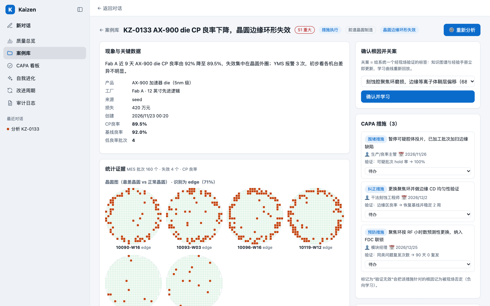
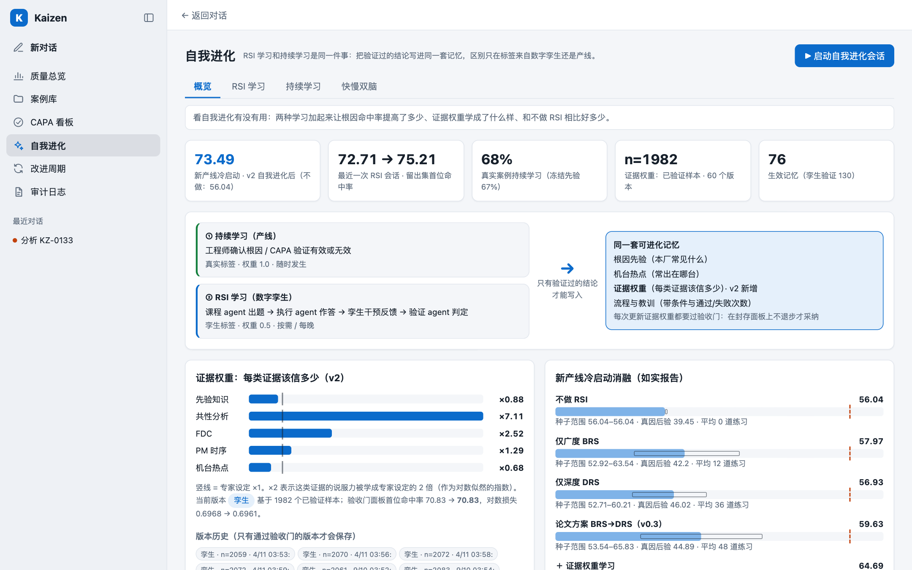
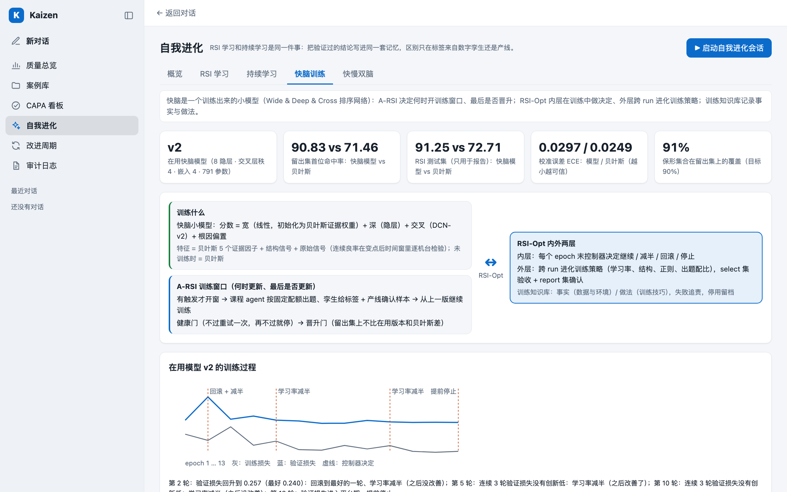
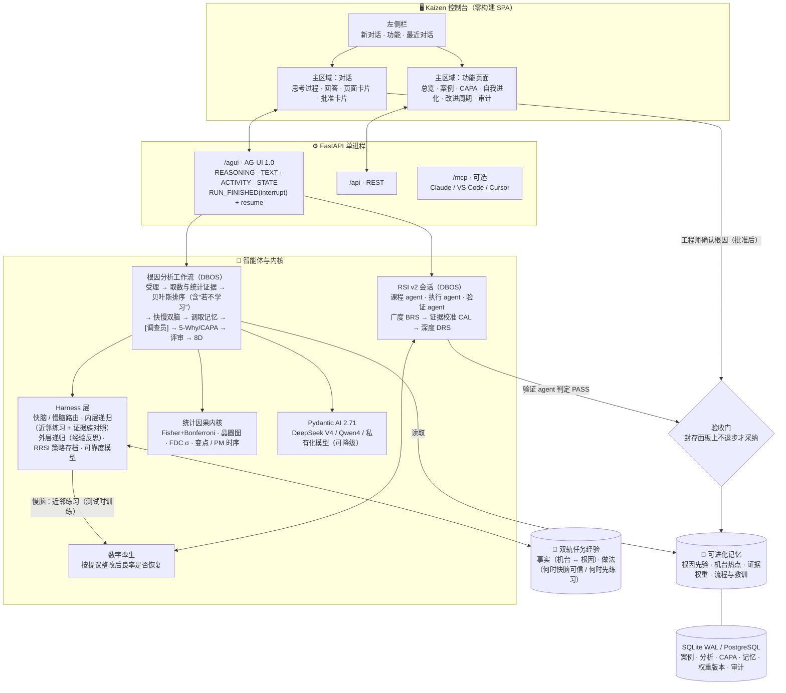
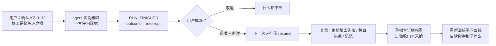

<div align="center">

# 🏭 Industry_RSI（Kaizen）

**面向 AI 芯片制造全流程（前道晶圆 → CP → 2.5D 封装 + HBM → FT/老化/SLT → 液冷整机柜）的质量根因分析智能体。统计因果内核给出可审计的证据；RSI 递归自我改进（数字孪生里三个 agent 自主练习，TTSE 双轨经验）和产线持续学习把验证过的结论写进同一套可进化记忆；快脑是一个训练出来的小排序模型（A-RSI 训练窗口 + RSI-Opt 内外层），通过晋升门才拿到裁决权；Harness 层管“这一案怎么答”——快慢双脑、慢脑探测裁决、改进经验库、RRSI 进化基础 harness；控制台基于 AG-UI 1.0，关案必须人工批准。**

[](https://python.org/)
[](https://fastapi.tiangolo.com/)
[](https://docs.ag-ui.com/)
[](https://www.dbos.dev/)
[](https://ai.pydantic.dev/)
[](https://modelcontextprotocol.io/)
[](https://sqlite.org/)
[](https://api-docs.deepseek.com/)
[](backend/tests)

</div>

---

## 📖 项目简介

本项目是一个面向**工业质量场景**的根因分析 + 自我进化 AI Agent 系统，项目内的智能体叫 **Kaizen**（改善）。它参考英伟达供应链和国内晶圆 / 封测大厂的产线，把每一次质量异常变成一个会自我改进的闭环：现场工程师在对话里描述问题或输入案例号，Kaizen 调取 MES / YMS / FDC 数据做统计分析，给出贝叶斯根因排序、5-Why、CAPA 和 8D 报告；工程师确认根因后，系统立刻告诉你它学到了什么。

**RSI 学习和持续学习是同一件事**：都把“验证过的结论”写进同一套记忆，区别只在标签从哪里来。

| 来源 | 结论怎么来 | 权重 | 什么时候发生 |
|---|---|---|---|
| 持续学习（产线） | 工程师确认根因、CAPA 验证有效 / 无效 | 1.0 | 随时 |
| RSI 学习（数字孪生） | 课程 agent 出题 → 执行 agent 作答 → 孪生干预反馈 → 验证 agent 判定 | 0.5 | 按需 / 每晚 |

### 核心架构理念

- **神经-符号复合**：根因排序由统计证据（Fisher 精确检验、晶圆图空间特征、FDC σ 偏移、PM 时序）和可进化记忆给出，过程确定、可审计；大模型只负责理解、解释和写作，没有 Key 时整套系统照常运行。
- **RSI v2 + TTSE**：参照 RSIAgent（arXiv:2609.15364），三个职责分离的 agent 在数字孪生里自主练习，**不训练模型参数**。在论文方案上做了几点改进：学习“每类证据该信多少”、加入证据校准批并按信息价值选题、每次更新都必须通过验收门；三个 agent 的经验按 TTSE（arXiv:2609.24289）分事实 / 做法两轨，失败追责到具体条目。
- **快脑小模型（v0.7）**：快脑不再是计数，而是一个训练出来的 Wide & Deep & Cross 排序网络，宽部分从贝叶斯证据权重起步。训练用在模型上：A-RSI 决定何时开训练窗口、最后是否晋升；RSI-Opt 内层在训练中做决定，外层跨 run 进化训练策略。通过晋升门才拿到快脑的裁决权，否则退回贝叶斯。
- **Harness 层**：参照 Agnes Harness 的快慢双脑与 Google Harness² 的双层递归。快脑把握够就直接给结论；否则慢脑让“近邻训练”和“贝叶斯意见”在本案的近邻探测题上和快脑比，明显赢了才改判。“哪个组件在什么条件下有效”写进改进经验库；RRSI 有触发才从改进库提议修改基础 harness。
- **三层三套门**：RSIAgent 的验收门、快脑训练的健康门与晋升门、harness 的选择门 + 上线门 + 观察期，全部用配对统计、分组护栏和轮换的留出题；报告里给出校准概率和“覆盖真因 90%”的根因集合，集合不止一个根因就标“需现场鉴别”。
- **人在回路**：关案会改写产线记忆，agent 不会直接执行，而是以 AG-UI 中断结束这次运行，你批准后才写入；批准人和备注进入审计日志。

### 适用场景

- **晶圆厂 / 封测厂质量工程**：良率下降、晶圆图失效、套刻超规、封装翘曲、HBM 凸点开路等异常的根因分析与 8D
- **新产线冷启动**：没有历史案例时，先在数字孪生里练习，把首位根因命中率从 56.0 提到 73.9（模拟数据，10 个种子平均）
- **经验沉淀**：工程师每确认一个根因，根因先验、机台热点、证据权重、排查流程都会更新，并能追溯到具体案例
- **Agent 工程实践**：自我改进的三角色制衡、验收门、DBOS 持久化工作流、AG-UI 中断与恢复、离线降级

**一句话总结**：不只是一个根因分析工具，而是一个会自己练习、会从产线学习、每一步都能追溯和撤销的工业质量 Agent。

---

## 📸 应用展示

<div align="center">

| 对话主页 | 对话中根因分析 |
|:---:|:---:|
|  |  |

| 关案需要人工批准 | 案例页面 |
|:---:|:---:|
|  |  |

| 自我进化 · 概览 | 自我进化 · RSI 学习 |
|:---:|:---:|
|  |  |

| 自我进化 · 持续学习 | 自我进化 · 快慢双脑 |
|:---:|:---:|
|  |  |

| 自我进化 · 快脑训练 | 审计日志（去年至今） |
|:---:|:---:|
|  |  |

</div>

演示库按时间回放了 2025-06 至今约 18 个月：138 个案例（120 个已关闭、12 个进行中、6 个待分析）、415 条 CAPA、18 次月度改进周期、11 次产线变更、12 次 RSI 会话、700 多条审计记录，全部带当时的时间。

控制台布局：**主区域默认是对话**；质量总览、案例库、CAPA 看板、自我进化、改进周期、审计日志放在**左侧栏**，点开后在同一主区域完整显示，点“← 返回对话”或任一条最近对话回来。agent 只在消息里放卡片（如“打开 KZ-0133 →”），不会自动切走对话。

---

## 🏗️ 系统架构



**一次关案怎么变成学习**：中断是 AG-UI 1.0 的原生能力，界面不需要特殊协议。



---

## ✨ 核心亮点

### 亮点一：RSI v2，三个角色互相制衡的递归自我改进

| 角色 | 独占的权力 | 做法 |
|---|---|---|
| 课程 agent | 决定练什么 | 按**信息价值**选题：知识梯度 KG(\*) × 证据模糊率，即“再练几道这类题，留出集期望命中率能涨多少”；连续 8 题没有新知识就停 |
| 执行 agent | 唯一能写记忆 | 用当前记忆做根因分析并提出整改；只在验证判定之后合并经验 |
| 验证 agent | 判真假 | 只看孪生的干预反馈：按提议整改后同一时段良率是否恢复；看不到执行 agent 的推理和记忆；改善低于量测噪声一律不通过 |

三个阶段：**广度 BRS**（12 题，按工段轮转保证覆盖）→ **证据校准 CAL**（480 道低成本练习，每波 24 题并行，难度易 : 中 : 难 = 2 : 4 : 4）→ **深度 DRS**（最多 36 题，失败驱动和压力测试）。在线模式下，校准题只用来学证据权重，不改动产线先验。

**产线变更驱动**：产线不是一成不变的。换供应商、新机台导入、PM 程序调整等变更同步到数字孪生后：
- 受影响症状学到的旧份额降权到 20%（部分遗忘），新证据会更快生效；
- 下一次 RSI 会话里，课程 agent 把这些症状的校准题比例提高到 4 倍，这部分校准题也会更新先验。

演示库里过去一年有 11 次产线变更。变更后的 11 次会话中，10 次提升了留出集首位命中率（+0.6 ～ +5.4）；另 1 次（老化板换插座）变更本身没有让命中率下降，结果标为“持平”并写明原因。

### 亮点二：学“每类证据该信多少”，而不只是“本厂常见什么”

v0.3 照搬论文方案，10 个种子复核后发现提升只是噪声（56.0 → 57.6）。诊断原因是手工设定的证据可信度偏保守：先验学得越有把握，强证据题反而从 88.5 掉到 78.2。v2 改为学习**证据权重**：以专家设定 ×1 为中心的条件 logit

```text
log P(根因 c | 证据 e) = Σ_k w_k · log factor_k(c) − log Z,    w = (先验, 共性分析, FDC, PM 时序, 机台热点)
```

用牛顿法加岭惩罚（向 w = 1 收缩）拟合，样本满 20 个才启用。结果：共性分析（Fisher 检验）的说服力被学成专家设定的 3～5 倍，FDC 约 1.2～1.9 倍，先验、PM、热点基本不变。

### 亮点三：三层三套门，防止“越改越差”

参照 OpsHarness（arXiv:2608.25661）：去掉验收门的自进化比不进化还差。Kaizen 每一层都有自己的门，名字不混用：

| 层 | 门 | 做法 |
|---|---|---|
| RSIAgent（记忆与证据权重） | 验收门 | 240 题封存面板；对数损失配对 bootstrap 区间上界 ≤ +0.01 且平均差 ≤ 0、命中率下界 ≥ −2 个百分点；任何症状变差不超过 0.15；每采纳一次就换一块全新的面板 |
| 快脑模型训练 | 健康门 + 晋升门 | 健康门：有限、不爆炸、学到了、不塌缩、不过拟合、温度正常、分症状不比贝叶斯差；晋升门：每晋升一次换一块全新的留出集，对数损失与命中率配对区间、ECE、对贝叶斯不退步、分症状护栏、保形覆盖 ≥ 87%、产线时间留出 |
| harness 配置（RRSI） | 选择门 + 上线门 + 观察期 | 选择门：白名单与防泄漏审查、search 初筛、select 验收（按候选数做 Bonferroni 校正）；上线门：每次全新的 report 题 + 产线回放；观察期：错误率显著高于上一版就回滚 |

v0.6 的门只比点估计、同一块面板一直用、只看平均；v0.7 都改成了配对统计 + 分组护栏 + 轮换（同一块留出集反复用来做决定，会被“调”进去，Dwork et al. 2015）。

### 亮点四：持久化工作流与降级

- **DBOS 3.6**：分析流程、RSI 会话、冷启动基准、夜间学习都是持久化工作流，每一步检查点到数据库，崩溃后从最后完成的那一步继续，不重复调用大模型。agent 决定每一步做什么，DBOS 负责记下来、断了接着跑。
- **离线可用**：没有配置大模型 Key 时，统计 + 贝叶斯内核仍然给出完整的排序、5-Why、CAPA 和 8D 报告；大模型失败时自动降级。
- **代码模式调查员**：配置大模型后，模型可以写 Python 在 Monty 沙箱里切分批次 / FDC / 晶圆图数据核查假设，结论以似然因子进入排序。

### 亮点五：快脑是一个训练出来的小模型，训练机制用在模型上

| 部分 | 参照 | Kaizen 怎么做 |
|---|---|---|
| 网络 | Wide & Deep（Google 2016）、DCN-v2（Google 2021）、列表式 softmax、温度缩放 | 宽部分从贝叶斯证据权重起步（未训练时 = 贝叶斯），深部分一层隐层，DCN-v2 交叉层（默认开启，秩 4），根因 ID 嵌入与偏置；纯 Python，几百个参数，毫秒级 |
| 特征 | — | 贝叶斯 5 个证据因子 + 乘积模型表达不了的结构信号（弱机台信号 × 热点记忆、变点是否在本工序、PM 是否在本工序机台……）+ **原始信号**：用连续良率 / 失效率，在整体变点之后的时间窗里逐工序、逐机台做 Welch t 检验（不二值化），再看变点前是否本来就差、是否刚做过 PM；刻意剔除会泄露答案的仿真伪迹 |
| 训练窗口 | A-RSI（arXiv:2610.38568） | 事件触发（新确认、产线变更、样本池饱和、慢脑频繁推翻快脑、产线命中率下滑）；课程 agent 按固定配额出题、孪生给标签；从上一版继续训练；健康门不过重试一次、再不过就停；晋升门见亮点三 |
| 训练策略 | RSI-Opt（arXiv:2610.32026） | 内层：每个 epoch 末控制器决定继续 / 减半 / 回滚 / 停止；外层：跨 run 进化学习率、结构、正则、出题配比，噪声带内只接受更便宜或更简单的（交叉层的秩例外：必须显著更好才改） |
| 训练知识库 | RSI-Opt 的跨 run 知识 | 事实（各症状当前首位根因、模型偏弱的分组）与做法（控制器规则、出题配比），失败追责、停用留档；事实被推翻（产线变了）就给该症状加倍出题 |

**没用 GBDT 的原因**：小规模表格数据上 GBDT 往往更强（Grinsztajn et al. 2022），但它要下载原生库，也不方便锚定上一版做连续训练。

### 亮点六：Harness 层——快慢双脑、慢脑探测裁决、RRSI 进化基础 harness

| 机制 | 参照 | Kaizen 怎么做 |
|---|---|---|
| 快慢双脑 | Agnes Harness 技术报告 §7 | 快脑模型的校准概率够高、保形集合只有首位、改进库没报过错就直接给结论；缺数据、S1、无先例、周期抽查、概率不够、集合不止一个根因、条件规则要求时转慢脑 |
| 慢脑（内层） | Harness² 的提议 → 探测 → 合成；Agnes Sys1 的逐请求 TTT | 课程 agent 出 36 道近邻孪生题，12 道做探测。**近邻训练**：执行 agent 作答、验证 agent 判定，只更新一份临时记忆，快脑模型冻结参数读它重排；**贝叶斯意见**：零成本的独立意见。挑战者在同一批探测题上明显赢过快脑才改判；有 Key 时大模型调查员再核查 |
| 外层与改进经验库 | Harness² 的改进库、Agnes 的标签撤销、Bayesian-Agent 的 Beta 阈值 | 记“在什么条件下快脑可信 / 近邻训练赢得过快脑”；没有行为差异不入库；答错追责，失败多了停用（留档）；推翻关案时撤回 |
| 回流到快脑 | Agnes：System 2 蒸馏到 System 1 | 慢脑推翻快脑 ≥ 8 次触发训练窗口，被推翻多的症状加倍出题；确认的案例进入下一次训练 |
| 跨 run 进化 | RRSI（arXiv:2609.24972） | 进化组件开关、旋钮与**条件规则**（只从改进库提议、过防泄漏审查）；改动预算退火 3 → 2 → 1、复杂度感知、剪枝；事件触发，连续两次没接受就退避；选择门 + 上线门 + 观察期 |

---

## 📊 效果与诚实报告

> 全部基于模拟数据：机台、产品、数值均为虚构，不代表任何真实企业。

**新产线冷启动消融**（从教科书知识出发；留出测试集 480 题，按根因分布分层抽样；10 个随机种子；v0.7 的验收门）：

| 模式 | 首位命中率（均值） | 最差种子 |
|---|---|---|
| 不做 RSI | 56.04 | — |
| 仅广度 BRS | 55.92 | 50.21 |
| 仅深度 DRS | 55.83 | 50.42 |
| 论文方案 BRS → DRS（v0.3） | 60.10 | 53.54 |
| ＋ 证据权重学习 | 63.77 | 55.83 |
| **＋ 证据校准（v2，默认）** | **73.92** | **70.21** |
| 参考天花板（知道孪生真实先验，且权重直接在测试集上拟合） | 74.58 | — |

v2 拿到了约 96% 的可提升空间，最差的一个种子（70.21）也好过 v0.3 最好的一个（65.83）。

| 度量 | 结果 |
|---|---|
| RSI 会话时间线（演示库，2025-12 至今 12 次，每次面对当时的数字孪生） | 12 次全部提升（+0.6 ～ +5.4）：首次 65.2 → 67.7；2026-01 测试座换供应商后 61.5 → 66.9；2026-10 新导入扫描机后 72.5 → 74.4；今天（清洗机换机械手）72.7 → 75.2 |
| 真实案例持续学习（预序回放：每个案例先预测、后学习，120 个已关闭案例） | 首位命中率 持续学习 68% vs 冻结在教科书先验 67%；近半程 78% vs 68%（产线变化越多，冻结先验越落后） |
| RSI 修正的盲区 | Fab D 41 天前新导入扫描机，“套刻匹配误差”在产线上从未出现过；RSI 在孪生里练过之后，KZ-0138 的首位是正确根因（快脑模型 > 99.9%，贝叶斯 97.6%），只用教科书先验则会排“镜头热效应”第一 |

**快脑小模型**（同一 480 题测试集；留出集每晋升一次换一块）：

| 对比 | 结果 |
|---|---|
| 原始信号特征（离线对照） | 贝叶斯 75.2% → 快脑（原特征）81.3% → **快脑（加原始信号）92.1%**；困难题 64.6% → 71.2% → **88.8%**；对数损失 0.69 → 0.49 → 0.23。原来的共性分析把良率二值化后再检验，弱异常时信息大多在这一步丢了 |
| 模型结构（离线对照，原特征） | Wide & Deep、DCN-v2 交叉层、深度集成（TabM 思路）、列表上下文（PRM / SetRank 思路）、GBDT（LambdaMART 式）都在 81% 左右：瓶颈在输入信息，不在模型结构 |
| 训练窗口（演示历史 4 个） | 2026-01 首个窗口晋升（测试集 91.0 vs 贝叶斯 66.9）；2026-06 晋升（91.3 vs 72.7）；2026-10 与今天没晋升：留出集上没有显著好过在用版本（对数损失区间上界 +0.019 / +0.006）。在用模型在今天的留出集上 92.5 vs 贝叶斯 78.5 |
| RSI-Opt 外层 | 4 个训练策略候选全部被拒：其中 3 个提议去掉交叉层，对数损失配对区间 [−0.010, +0.008] 不显著，按“必要时才改”的规则不接受；另 1 个改进不显著。在用的仍是基线策略（交叉层秩 4，约 790 个参数） |
| 训练知识库 | 16 条“某症状首位根因”的事实被后来的窗口推翻（产线变了），对应症状在下个窗口加倍出题 |

**快慢双脑（孪生 report 题，与 RRSI 搜索、选择用的题互不重叠）**：

| 配置 | 首位命中率 | 快脑接手 | 快脑答错 | 保形集合覆盖 |
|---|---|---|---|---|
| 只用贝叶斯 | 86.1 | 100% | 10 | 100% |
| 只用快脑模型 | **97.2**（对贝叶斯配对差 95% 区间 [+4.2, +18.1]） | 100% | 2 | 99% |
| 快慢双脑 | 97.2 | 75% | **0** | 99% |
| **压力场景**：产线刚变更、模型和记忆都没跟上（WM_EDGE / TEST_VMIN 主因对调） | 贝叶斯 57.5 → **快脑模型 92.5** = 快慢双脑 92.5 | | | |

- 加了原始信号之后，快脑模型在平常题和压力场景里都明显好过贝叶斯：原始信号能直接定位出问题的机台，不太依赖“本厂哪个根因常见”这类会过时的先验。
- 平常场景下慢脑的价值是“哪些结论可以直接信”：快脑接手的 75% 一题没错。演示历史 132 次分析里快脑接手 33 次，已确认的 30 次全部正确（95% 区间 89%–100%）。
- 快脑变强之后，近邻训练不再划算：RRSI 在 2026-01 的运行里提议关掉它，命中率在噪声带内、孪生仿真次数少 10% 以上，在全新的 report 题和产线回放上也不退步，于是上线（RRSI 的复杂度感知正是为这种情况设计的）。现在慢脑只做探测题 + 贝叶斯意见，压力场景里快脑模型自己就追回了。
- 慢脑在演示历史里改判 10 次（近邻训练 8 次，都在它被关掉之前；贝叶斯意见 2 次），已确认的 5 次里改判后对 1 次、快脑原本也只对 1 次——产线上没体现出净收益。
- 合并挑战者的依据（合并前的演示数据）：只调快脑偏置层的挑战者在 48 次慢脑里只赢过快脑 1 次；合并后的近邻训练（临时记忆 + 冻结的快脑模型）在两组压力题上探测命中 126 / 144 与 116 / 144，原来的贝叶斯近邻练习是 121 与 100。
- RRSI 共 4 次运行（2026-01、06、10 和今天）、25 个候选，上线 1 个（上面关掉近邻训练的那个），其余被选择门拒绝。

**局限**：孪生的根因分布和机台热点目前是演示用的虚构值。真实部署前必须用本厂历史数据校准孪生，否则学到的是孪生而不是产线，这也是孪生经验权重（0.5）低于产线确认（1.0）的原因。

---

## 🛠️ 技术栈

| 组件 | 技术 | 版本 | 用途 |
|---|---|---|---|
| 运行时 | Python | 3.12 | 后端与全部算法 |
| Web 框架 | FastAPI + Uvicorn | 0.165 / 0.54 | REST、AG-UI 流式端点、静态控制台 |
| 智能体 ↔ 界面 | AG-UI（`ag-ui-protocol`） | 1.0.0 | 思考过程、面板卡片、状态、子 agent、中断与恢复 |
| 持久化工作流 | DBOS | 3.6.0 | 分析流程、RSI 会话、冷启动基准、夜间学习；崩溃续跑 |
| 大模型调用 | Pydantic AI + pydantic-ai-harness | 2.71.0 / 0.71.0 | 类型化输出与校验重试；代码模式调查员（Monty 沙箱） |
| 大模型 | DeepSeek V4 / 通义 Qwen4 / vLLM 私有化 | OpenAI 兼容 | 5W2H、5-Why、措施细化、评审、追问；可降级 |
| 数据 | SQLModel + SQLite（WAL）/ PostgreSQL | 0.0.50 | 案例、分析、CAPA、记忆、证据权重版本、RSI 会话、审计 |
| 工具协议（可选） | MCP Python SDK + MCP Apps | 2.3.0 | 供 Claude / VS Code / Cursor 等客户端调用 |
| 前端 | 原生 JS + CSS（零构建） | — | 左侧栏 + 主区域布局、SVG 图表、晶圆图、鱼骨图 |
| 部署 | Docker Compose + Nginx | — | 单机部署；可选 PostgreSQL |

---

## 🚀 快速开始

### 本地运行

```bash
git clone https://github.com/Gaogxx/Industry_RSI.git && cd Industry_RSI
./scripts/dev-backend.sh      # 首次自动用 uv 建 venv；打开 http://localhost:8000
```

启动耗时（Apple Silicon 笔记本实测）：

| | 服务器可用 | 演示数据就绪 |
|---|---|---|
| 首次启动（空数据库） | 约 2 秒 | 在后台生成，界面顶部显示进度；生成期间可以先浏览，数据会陆续出现。v0.6 实测约 2.7 分钟（测量时机器上另有训练任务占用约 6 个核，负载约 20）；v0.5 没有 harness 时空闲机器约 40 秒 |
| 之后再启动 | 约 2 秒 | 立即 |

首次启动在后台按时间回放去年至今的产线（含 11 次历史 RSI 会话；每个历史案例都走一遍快慢双脑，慢脑会做近邻练习），同时在独立进程里跑冷启动基准，最后跑今天的自我进化会话、可靠度模型训练窗口、RRSI 策略进化和快慢双脑孪生对照。练习题用多进程并行（`KAIZEN_RSI_WORKERS`，默认 CPU 核数 − 2，最多 8）。中途关掉也没关系：下次启动会从断点继续。

打开后在对话里试试：

1. `分析 KZ-0138`：国产 DUV 多重图形套刻超规（Fab D 上个月新导入了一台扫描机），首位根因来自 RSI 在孪生里学到的知识；
2. `确认 KZ-0133 根因是刻蚀腔聚焦环磨损`：弹出批准卡片，批准后才写入产线记忆并重拟合证据权重；
3. 模式选“自我进化”，发送 `启动一次自我进化会话`：对话里的卡片实时显示三阶段进度和得分曲线；
4. 左侧栏打开“自我进化”，看概览 / RSI 学习（去年至今的会话时间线）/ 持续学习；案例库、CAPA 看板、改进周期、审计日志里都是去年至今的历史记录。

接入大模型（可选）：

```bash
KAIZEN_LLM_API_KEY=<你的 Key> KAIZEN_LLM_MODEL=deepseek-v4-pro ./scripts/dev-backend.sh
```

课程 agent 可以用不同的模型家族：`KAIZEN_RSI_CURRICULUM_MODEL=qwen4-max`，对应论文里执行与课程 / 验证分属不同模型的设计。密钥只从环境变量读取，不写进代码。

### 生产部署

```bash
cd deploy && cp .env.example .env && chmod 600 .env   # 填写 KAIZEN_API_KEY，可选 LLM_API_KEY
docker compose up -d --build                         # Kaizen + Nginx，http://<服务器>/
```

详见 [docs/03-部署运维.md](docs/03-部署运维.md)。

### 测试

```bash
cd backend && .venv/bin/python -m pytest -q
```

73 个测试（离线；包含整套演示数据生成，本机空闲时约 2–3 分钟，机器满负载时约 5 分钟）：统计内核、贝叶斯学习、DBOS 端到端、RSI v2（孪生 / 三角色 / 证据权重 / 验收门 / 知识梯度 / 消融 / 在线会话 / TTSE 双轨的追责与测试时检索）、快脑小模型（贝叶斯等价初始化 / 原始信号定位机台且不用批次字段 / 旧维度模型退回贝叶斯 / 交叉层秩默认 4、显著更好才改 / 反向传播数值校验 / 训练窗口的健康门与晋升门 / RSI-Opt 外层存档 / 训练知识库的事实推翻与做法停用）、Harness（路由规则 / 探测裁决 / 近邻训练追回产线变更 / 改进库的门控与停用 / 条件规则白名单与防泄漏审查 / RRSI 事件触发与退避 / 观察期统计回滚）、AG-UI、MCP、脚本化 LLM、鉴权。

---

## 📁 项目结构

```
Industry_RSI/
├── backend/
│   ├── app/
│   │   ├── main.py              # 服务入口：/ 控制台 · /agui · /api · /mcp（可选）· /healthz
│   │   ├── agui.py              # AG-UI 1.0 端点：事件映射、关案中断与恢复、自我进化直播
│   │   ├── chat.py              # 对话技能：分析 / 建案 / 追问 / 确认根因 / 改进教练
│   │   ├── api.py               # REST：案例、CAPA、学习曲线、证据权重、RSI 会话、审计
│   │   ├── services.py          # 建案、分析、关案学习、CAPA
│   │   ├── agent/               # 分析工作流（DBOS 步骤）、提示词、8D 报告、代码模式调查员
│   │   ├── fab/                 # 产线模型（工段 / 症状 / 根因）、统计内核、知识图谱、学习与回放、演示数据生成
│   │   ├── rsi/                 # RSI v2：数字孪生、三角色、BRS/CAL/DRS 引擎、证据权重与验收门、TTSE 双轨记忆、工作流
│   │   ├── fastbrain/           # 快脑小模型：特征、Wide & Deep & Cross 网络、A-RSI 训练窗口、RSI-Opt 内外层、训练知识库
│   │   ├── harness/             # Harness 层：快慢双脑、慢脑探测裁决、改进经验库、组件配置与条件规则、RRSI
│   │   ├── ledger.py · stats.py # Beta 账本（经验条目共用）、配对 bootstrap 与 Wilson 区间
│   │   ├── improvement.py       # KPI、帕累托、改进周期
│   │   ├── mcp_server.py        # 可选 MCP 工具与 MCP Apps 看板
│   │   ├── models.py · db.py    # 数据模型与数据库（结构变化时自动备份旧库）
│   │   ├── seed.py              # 演示数据：按时间回放去年至今的案例、CAPA、产线变更、改进周期、RSI 会话、审计
│   │   └── static/              # 控制台：index.html · app.js · styles.css（零构建）
│   ├── tests/                   # pytest（离线）
│   ├── Dockerfile
│   └── pyproject.toml
├── deploy/                      # docker-compose.yml · nginx.conf · .env.example
├── scripts/dev-backend.sh       # 本地启动
└── docs/
    ├── 01-行业背景与调研.md
    ├── 02-架构设计.md
    ├── 03-部署运维.md
    ├── 04-芯片制造产线与前沿技术调研.md
    ├── 05-RSI与Harness文献对照.md
    └── screenshots/
```

---

## 🔌 接口

| 入口 | 说明 |
|---|---|
| `GET /` | 控制台；`#/cases/133`、`#/evolution?tab=rsi`、`#/c/<对话 id>` 等深链接 |
| `POST /agui` | AG-UI 1.0：`forwardedProps.mode` = `rca`（根因分析）/ `coach`（改进教练）/ `rsi`（启动并直播自我进化会话）；关案以 `outcome=interrupt` 结束，带 `resume` 批准后执行 |
| `/api/cases` · `/api/actions` | 案例、分析、关案学习、CAPA |
| `/api/rsi/*` | 自我进化会话、冷启动基准、知识缺口（含信息价值） |
| `/api/learning/*` · `/api/memory` | 学习曲线、根因先验、证据权重版本与验收门、可进化记忆 |
| `/api/fastbrain` · `POST /api/fastbrain/{train,optimize}` | 快脑训练窗口（健康门 / 晋升门 / 控制器决定）、训练策略存档、训练知识库；手动开窗、手动跑 RSI-Opt |
| `/api/harness` · `POST /api/harness/{evolve,benchmark}` | 快慢双脑收据统计、慢脑裁决、改进经验库、RRSI 配置存档、孪生对照 |
| `/mcp` | 可选：MCP Streamable HTTP（`KAIZEN_ENABLE_MCP`） |

---

## 📄 License & 免责声明

- 代码采用 MIT License（见 [LICENSE](LICENSE)）。
- 演示数据和数字孪生全部为模拟，机台、产品、数值均为虚构，不代表任何真实企业。系统给出的根因与措施需要由质量工程师确认后执行。

## 致谢

本项目的做法直接参考了下面这些工作（逐条怎么用的，见 [docs/05-RSI与Harness文献对照.md](docs/05-RSI与Harness文献对照.md)）。

**递归自我改进与自进化**
- [RSIAgent](https://arxiv.org/abs/2609.15364)（[代码](https://github.com/AetherLabsAI/RSIAgent)）— 课程 / 执行 / 验证三角色的递归自我改进，Kaizen 的主线
- [OpsHarness](https://arxiv.org/abs/2608.25661) — 去掉验收门的自进化比不进化还差；验收门的依据
- [A-RSI](https://arxiv.org/abs/2610.38568) — 程序化出题、按日志换池、健康门与回滚；快脑训练窗口“何时更新、最后是否更新”
- [RSI-Opt](https://arxiv.org/abs/2610.32026) — 训练过程中的决策点控制（内层）与跨 run 的策略进化（外层）
- [SEAL](https://arxiv.org/abs/2607.24300) — “更新后的表现即奖励”；连续自编辑的遗忘问题
- [五大路线综述](https://arxiv.org/abs/2607.07663) — 模型级 / 提示框架 / 记忆技能 / 自改代码 / 多智能体的取舍
- [Harness Evolution Hits a Ceiling](https://arxiv.org/abs/2610.11655) — 什么时候才值得训练权重

**Harness 与经验**
- Agnes Harness 技术报告（AgnesAI-Labs，2026-11）与 Sys1 1.0 报告 — 快慢双脑（System 1 / System 2）、交还慢脑的情形、逐请求测试时训练、上线观察期
- [Harness²](https://arxiv.org/abs/2610.14224)（[代码](https://github.com/google-research/harness2)）— 任务级 + 改进级的双层递归与改进经验库
- [RRSI](https://arxiv.org/abs/2609.24972)（[代码](https://github.com/google-research/rrsi)）— 正则化的 harness 递归自改进：改动预算退火、稳定性下限、复杂度感知、剪枝
- [TTSE](https://arxiv.org/abs/2609.24289) — 事实 / 做法双轨经验、追责与停用；用在 RSIAgent 的三个 agent 上
- [Bayesian-Agent](https://arxiv.org/abs/2606.08348) — 经验即假设，Beta 后验的停用 / 稳定阈值
- [Darwin Gödel Machine](https://arxiv.org/abs/2505.22954) — 跨 run 存档与父代采样
- [ACE](https://arxiv.org/abs/2510.04618) · [ReasoningBank](https://arxiv.org/abs/2509.25140) · [Voyager](https://arxiv.org/abs/2305.16291) · [Reflexion](https://arxiv.org/abs/2303.11366) — 经验 / 技能库的增量合并与验证后入库
- [ADAS](https://arxiv.org/abs/2408.08435) · [TextGrad](https://arxiv.org/abs/2406.07496) · [DSPy](https://arxiv.org/abs/2310.03714) · [GEPA](https://arxiv.org/abs/2507.19457) — 提示与框架进化的验证集准入、多次运行加区间做决定
- [SPIN](https://arxiv.org/abs/2401.01335) · [Self-Rewarding](https://arxiv.org/abs/2401.10020) · [R-Zero](https://arxiv.org/abs/2508.05004) — 固定真值锚点、出题难度，以及“不把自己的高置信结论当标签”的教训
- [AlphaEvolve](https://arxiv.org/abs/2506.13131) · [Gödel Agent](https://arxiv.org/abs/2410.04444) · [STOP](https://arxiv.org/abs/2310.02304) — 存档、分级评估；以及为什么产线运行时不让 agent 改自己的代码

**快脑小模型与可靠性**
- [Wide & Deep](https://arxiv.org/abs/1606.07792)（Google）· [DCN-v2](https://arxiv.org/abs/2008.13535)（Google）— 快脑排序网络的结构
- ListNet（Cao et al., ICML 2007）— 列表式 softmax 排序损失
- [温度缩放](https://arxiv.org/abs/1706.04599)（Guo et al. 2017）— 概率校准
- [Test-Time Training](https://arxiv.org/abs/1909.13231)（Sun et al. 2020）— 慢脑的测试时训练
- [分割保形预测](https://arxiv.org/abs/2107.07511)（Angelopoulos & Bates）— 覆盖率有保证的根因集合
- [可复用留出集](https://arxiv.org/abs/1506.02629)（Dwork et al. 2015）— 三套门的面板 / 留出集轮换
- [Why do tree-based models still outperform deep learning on tabular data?](https://arxiv.org/abs/2207.08815) — 选模型时的对照依据

**课程与信息价值**
- [相关知识梯度](https://people.orie.cornell.edu/pfrazier/pub/CorrelatedKG.pdf)（Frazier, Powell & Dayanik）· [EPIG](https://arxiv.org/abs/2304.08151) · [贝叶斯实验设计综述](https://arxiv.org/abs/2302.14545) — 课程 agent 按信息价值出题

**工程**
- [AG-UI](https://github.com/ag-ui-protocol/ag-ui) · [DBOS](https://github.com/dbos-inc/dbos-transact-py) · [Pydantic AI](https://github.com/pydantic/pydantic-ai) · [FastAPI](https://github.com/fastapi/fastapi) · [MCP](https://github.com/modelcontextprotocol) · [SQLModel](https://github.com/fastapi/sqlmodel)
